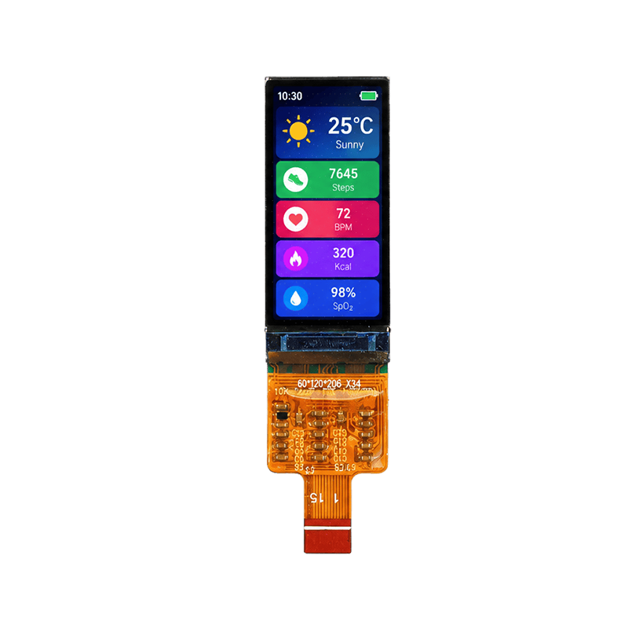

<p align="left"></p>

<h1 align="center">OSPTEK 0.95″ AMOLED Display 120×240 (AM095Q120240LK1)</h1>

<p align="center"><b>AMOLED module · QSPI · SH8501A</b></p>

<p align="center"><a href="./README.md">简体中文</a> | English · <a href="../../README_EN.md">Family index</a></p>

<p align="center">
  
  
</p>

<p align="center"></p>

## Contents

- [Specifications](#specifications)
- [Resources](#resources)
- [Repository layout](#repository-layout)
- [Buy](#buy)
- [Support](#support)

---

## Specifications

| Item | Spec |
| ---- | ---- |
| Size | 0.95 inch |
| Type | AMOLED |
| Resolution | 120×240 |
| Outline | 12.80 x 27.35 mm |
| Active area | 10.80 x 21.60 mm |
| Interface | QSPI |
| Driver IC | SH8501A |
| Touch IC | — |

> Full outline, FPC definition, power, and timing follow the product datasheet / driver IC datasheet.

## Resources

| Category | File |
| ---- | ---- |
| Datasheet | [`AM095Q120240LK1.pdf`](./datasheets/AM095Q120240LK1.pdf) |
| CAD file | [`AM095Q120240LK1.dwg`](./cad/AM095Q120240LK1.dwg) |
| Adapter materials | [`转接板.png`](./adapter/%E8%BD%AC%E6%8E%A5%E6%9D%BF.png) |
| Adapter materials | [`ADP-AMOLED-095-SPI-15P-V1.1.pdf`](./adapter/ADP-AMOLED-095-SPI-15P-V1.1.pdf) |

## Repository layout

```text
display-amoled-0.95inch-120x240/ # repo root (nav: ../../README_EN.md; sample projects under root examples/)
└── versions/
    └── AM095Q120240LK1/        # full materials for this part number
        ├── README.md
        ├── README_EN.md
        ├── osptek.yml
        ├── images/
        ├── datasheets/       # product datasheet + driver/touch IC datasheets
        ├── cad/              # outline/cover CAD
        └── adapter/          # adapter board materials + photos
```

## Buy

See the [repo home page](../../README_EN.md#where-to-buy).

## Support

See the [repo home page](../../README_EN.md#support).

---

<p align="center"><sub>© 2026 OSPTEK · Materials in this repository are licensed under CC BY 4.0</sub></p>
